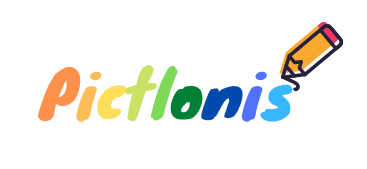

<p align="center">
  
</p>

<h1 align="center">Pict-ionis</h1>

<p align="center">
  <strong>Draw on your phone, let your friends guess in the chat.</strong><br>
  A Pictionary-like mobile app built with React Native and Expo: password-protected rooms,
  a shared canvas synced through Firestore and a live chat for the guesses.
</p>

<p align="center">
  <a href="#quick-start">Quick start</a> &middot;
  <a href="#how-it-works">How it works</a> &middot;
  <a href="#screens">Screens</a> &middot;
  <a href="#tech-stack">Tech stack</a> &middot;
  <a href="#documentation">Documentation</a>
</p>

<p align="center">
  
  
  
  
  
</p>

<p align="center">
  
  <br>
  <sub>The wordmark shown on the sign-up and login screens, from <code>assets/pictlonis_logo.png</code>.</sub>
</p>

---

Pictionary needs a sheet of paper, a pen and everyone in the same room. Moving it to a phone
means one player draws while the others watch the strokes appear and type their guesses, all
in real time, without a game server to write and host.

**Pict-ionis** was a mobile development project at ETNA (2021-2022). It is an Expo app in which
players sign up with an email and a password, create or join a room protected by a password,
and share a canvas and a chat. Firebase does all the back-end work: Authentication for the
accounts, Firestore for the rooms, the messages and every stroke drawn. The first player who
draws in a room becomes its drawer; the other players receive each path as it is written and
see it replayed on their own canvas, then guess in the chat under the drawing.

The name is Pictionary crossed with IONIS, the education group ETNA belongs to. The app id and
the wordmark spell it Pictlonis. The project is finished and no longer maintained.

## Quick start

**Prerequisites:** Node.js and npm, the Expo CLI of the SDK 42 era (`npm install -g expo-cli`),
the Expo Go app on an Android or iOS device (or an emulator), and a Firebase project with
Email/Password authentication and Firestore enabled.

```sh
git clone https://github.com/verovec/Pict-ionis.git && cd Pict-ionis
npm install
npm start                # expo start: Metro bundler and a QR code to open in Expo Go
npm run android          # or: npm run ios, npm run web
```

The Firebase configuration lives in `database/firebase.js`; replace the `firebaseConfig`
object with the one of your own project before running. Then create an account on the Signup
screen, add a room with the `+` icon and open it from the Home list.

## How it works

```
  Providers     PaperProvider > AuthProvider (login, register, logout) > Routes
     |
  Routes        subscribes to firebase.auth().onAuthStateChanged; AuthStack or HomeStack
     |
  Signup/Login  createUserWithEmailAndPassword or signInWithEmailAndPassword
     |
  Home          the THREADS collection, live, ordered by latestMessage.createdAt
     |
  AddRoom       a new THREADS document: name, password, a system welcome MESSAGE
     |
  PasswordRoom  the typed password is compared with the document's, then Room or back Home
     |
  Room          a Draw canvas and a GiftedChat; strokes go to DRAW, messages to MESSAGES
```

Every screen talks to Firestore directly with `onSnapshot` listeners, so there is no API of
its own. Writes are plain `add` and `set({ merge: true })` calls. The data model is in
[`docs/architecture.md`](docs/architecture.md#firestore-data-model).

## Screens

| Screen | File | Navigator | What it does |
|--------|------|-----------|--------------|
| Signup | `components/signup.js` | AuthStack (initial) | name, email, password; `register` from the auth context |
| Login | `components/login.js` | AuthStack | email, password; `login` from the auth context |
| Loading | `components/loading.js` | shown by Routes | spinner while the auth state is unknown |
| Home | `components/dashboard.js` | HomeStack > ChatApp | list of rooms, logout on the left, new room on the right |
| AddRoom | `components/AddRoomScreen.js` | HomeStack (modal) | create a room with a name and a password |
| PasswordRoom | `components/passwordRoom.js` | HomeStack > ChatApp | type the room password to enter |
| Room | `components/RoomScreen.js` | HomeStack > ChatApp | the shared canvas (400 x 450) above the chat |

`components/draw.js` and `components/chat.js` are earlier versions of the room, still
registered in AuthStack but not reachable from any button.

## Tech stack

| Layer | Tech | Location |
|-------|------|----------|
| App shell | Expo SDK 42, React Native, React 16.13 | `App.js`, `app.json`, `babel.config.js` |
| Navigation | React Navigation 6 (stack), two navigators switched on auth state | `navigation/` |
| UI kit | react-native-paper 4 (lists, icons), status bar from Expo | `components/` |
| Drawing | `@benjeau/react-native-draw` canvas, paths serialised to Firestore | `components/RoomScreen.js` |
| Chat | react-native-gifted-chat 0.16 | `components/RoomScreen.js` |
| Back end | Firebase 8.2 JS SDK: Authentication and Firestore | `database/firebase.js` |
| Assets | icon, splash, adaptive icon, wordmark | `assets/` |

Details in [Architecture](docs/architecture.md).

## Documentation

| Topic | Where |
|-------|-------|
| Providers, navigation, screens, Firestore data model, drawing sync | [`docs/architecture.md`](docs/architecture.md) |
| Running with Expo, Firebase setup, dependencies, cleaning up | [`docs/development.md`](docs/development.md) |
| Everything else | [`docs/`](docs/README.md) |

## Contributing

This repository is an archived school project and is kept as it was delivered. Issues are still
welcome if something in the documentation is wrong or if you want to discuss the approach.
